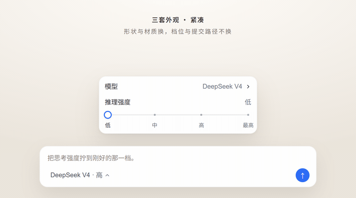
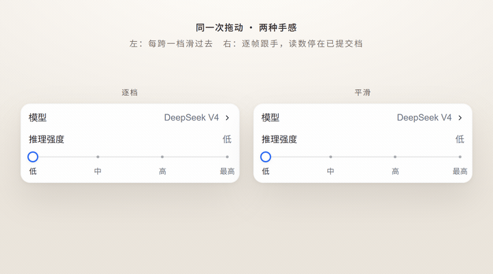
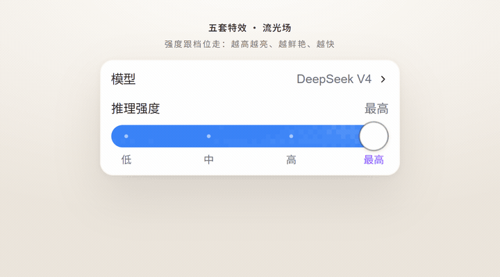

# dsh-yet-another-slider-thingy

把 DSH composer 的**模型位**（`conversation.input.model`）换成「模型行 + 思考强度滑条」：
模型行照旧下钻到按提供方分组的模型列表，推理强度是带卡位的离散滑条，拖动方式可切**逐档**
（默认，指针始终吸在刻度上）或**平滑**（拇指连续跟手，松手吸附到最近档）。面板材质直接用宿主的
`MenuSurface`，档位、分组、pending 与提交路径都来自宿主同一份模型目录。

```
┌──────────────────────────── 320 ─┐
│ 模型              DeepSeek V4   › │
│ 推理强度                    High  │
│  ●────────○────────○────────○     │
│ 关闭       低        高       最高 │
└──────────────────────────────────┘
```

外观可切：**紧凑**（默认，细轨）/ **块面**（暖灰整块轨道 + 圆角方拇指）/ **胶囊**（胶囊轨 + 白圆拇指 + 蓝色进度）。
紧凑与胶囊的拇指形状还能单独切：紧凑可在**圆角方**（现在这版的样子）与**圆**之间选，胶囊可在**圆**（现在这版）与**圆角方**（旧版胶囊的样子，轨道两端同时收成圆角矩形）之间选；块面固定圆角方。三套共用同一套档位与提交路径，只换形状与材质——颜色是独立的**配色**层。拇指另有**大小**两档（标准 / 大），三套外观通用。

**特效**（关 / 跟随外观 / 流光场 / 密度粒子 / 心跳 / 字符点阵 / 渐变）、**底部刻度**与**配色**是三项独立设置：前两项默认「跟随外观」，配色默认「自动」（不覆盖颜色），
所以不碰设置时三套外观各是各的样子；想混搭就把它们改掉——例如把流光场借到块面上，或让胶囊也显示
`Faster / Smarter` 两端字，再选一套「Claude 风」配色盖到任一形状上。

## 预览



同一次拖动，两种手感——左边逐档，每跨一档滑过去；右边平滑，拇指逐帧跟手、读数停在已提交档。



五套特效，强度跟档位走；「跟随外观」时只有胶囊默认带密度粒子。
渐变可以自己填色标，留空就跟随当前配色。



## 安装

应用内插件管理器：设置 → 插件 → 添加插件。先把仓库克隆到任意目录（示例是 Windows 路径）：

```powershell
git clone https://github.com/Traveritas/dsh-yet-another-slider-thingy.git D:\dsh\dsh-yet-another-slider-thingy
```

然后在 spec 里填克隆目录的绝对路径：

```
D:\dsh\dsh-yet-another-slider-thingy
```

装好后在**设置 → 思考强度**里开关、切外观、拇指形状与大小、特效、刻度、配色与拖动方式。设置页按「滑条 / 特效 / 配色」三类分组，
每行的说明文字靠右；窄窗口里说明会落到控件下方。桌面端没有 HMR 时需要完整重启；有 HMR 时保存后约二十秒
热加载。

## 行为

- 触发按钮照抄原生：28px、13px、「模型名 · 档名」、pending 时用 `StateDot` 代替箭头。
- 滑条是**离散**的：档位来自适配器公布的 `reasoning.efforts`（不同模型可能是 3 档或 4 档，名字原样显示）。拖动只改视觉，**松手、点刻度、或键盘停手 200ms
  才提交**；提交后面板不关，方便连续微调。
- **拖动方式**在设置里切：`逐档`（默认）指针每动一下就取整到刻度，读数与高亮跟着指针走，
  拇指与填充用该外观的缓动从一档滑到下一档，圆点变色同步淡入（跨档不再瞬移）；`平滑` 时拇指与填充连续跟手，
  读数、圆点 / 刻度高亮和 aria 停在**已提交档**，松手按最近档吸附
  （用各外观现有的缓动滑回去）并提交，提交后这些指示才一起更新——连续拖动时不会每越过一条
  档位中线就来回翻。平滑只改手感——宿主只接受离散 `reasoningEffort`，不会产生中间值。
- 键盘：轨道 `role="slider"`，←/→（及 ↑/↓）逐档、PageUp/PageDown 逐档（与原生 range 一致）、
  Home/End 到两端；Esc 退出子面板或关闭；Shift+Tab 关闭。
- 换模型：同 id 档位保留，目标模型没有该档就按序号就近钳制；目标模型没有推理元数据时不带
  `reasoningEffort`（走目录默认）。
- 失败：滑条回滚到已提交档，用原生 `Toast`（锚在 composer 卡片上）报错；`select` 返回
  `ok:false`、reject、同步抛三条路都会落到 Toast。目录加载失败仍是面板内的错误条 + 重试。
  `available === false`（subagent 会话）整座不渲染。
- 设置存在 `localStorage["dsh-yet-another-slider-thingy:enabled"]`，`off` = 关；关掉立刻回原生菜单。
- 外观存在 `localStorage["dsh-yet-another-slider-thingy:style"]`，`compact` / `claude` / `codex`（设置里显示成
  紧凑 / 块面 / 胶囊）；只换形状与材质，不改档位、提交时机或失败回滚。
- 拇指形状存在 `localStorage["dsh-yet-another-slider-thingy:knobs"]`，按外观各记一份：
  `{"compact":"square"|"circle","claude":"square","codex":"circle"|"square"}`；坏值回落到各外观的默认
  （紧凑圆角方、块面圆角方、胶囊圆）。
- 拇指大小存在 `localStorage["dsh-yet-another-slider-thingy:knobSize"]`，`md` / `lg`（标准 / 大，
  默认 `md`）；只缩拇指与 pad，轨道高度不变。旧版存的 `sm` 读回按 `md` 处理。
- 特效存在 `localStorage["dsh-yet-another-slider-thingy:effects"]`，`auto`（默认，只有胶囊有密度粒子）/
  `off` / `flow` / `dust` / `pulse` / `glyph` / `gradient`——设置里显示成关 / 跟随外观 / 流光场 / 密度粒子 / 心跳 /
  字符点阵 / 渐变。旧版存的 `on` 读回来按 `dust` 处理，不算丢设置。紧凑的 2px 填充放不下粒子与字符，
  会自动降级成只有一道流光；渐变只是一层颜色，细轨照画。
- 特效自己的设置存在 `localStorage["dsh-yet-another-slider-thingy:fx"]`，形如
  `{ "maxOnly": false, "trail": true, "trailLength": "short", "speeds": { "flow": 1, "dust": 1, "pulse": 1, "glyph": 1, "gradient": 1 }, "gradient": { "colors": [], "reverse": false } }`：
  `maxOnly` 是「只在最高档出现」，`trail` 是密度粒子尾迹（默认 `true`，旧版没有这项按开读），
  `trailLength` 是尾迹长度（`short` / `medium` / `long`，默认 `short`），
  `speeds` 是每个样式各一份的速度倍率（0.7 / 1 / 1.4），
  `gradient.colors` 是渐变色标（`#rrggbb`，空数组 = 跟随配色，至少两枚才生效），
  `gradient.reverse` 是流动方向（`false` 往左、`true` 往右）。
- 底部刻度存在 `localStorage["dsh-yet-another-slider-thingy:labels"]`，`auto`（默认，块面两端字、其余档位名）/
  `ticks`（每档名字，可点）/ `axis`（`Faster / Smarter` 两端字）/ `none`（不留这一行）。
- 拖动方式存在 `localStorage["dsh-yet-another-slider-thingy:smooth"]`，`step` / `smooth`；切换立即生效，不重建座位。
- 配色存在 `localStorage["dsh-yet-another-slider-thingy:palettes"]`（数组）与 `:palette`（当前选中的 id，`auto` = 不覆盖），
  形如 `[{ "id": "mine", "name": "暮紫", "light": { "fill": "#6f5685" }, "dark": {} }]`；空槽表示跟随主题。
- 旧版按外观存的 `:colors`（`{"claude":{"fill":"#…"}}`）在升级时按外观拆成独立配色，名字带「旧自定义 · 块面」，
  并自动选中当前外观那一套——不会静默丢色。
- **冷启动竞态（已按根因处理）**：宿主的 `ModelDirectoryResolver` 内部会摸 `ctx.remote.session`，而 Cordis 的
  reflect 代理按「调用方 ctx 的 inject 声明」放行——座位比原生早渲染几毫秒时就会抛
  `cannot get property "remote.session" without inject`，被错误边界退役。现在先等
  `remote` / `remote.session` 就绪，再用**声明了它们的注入 scope** 注册座位；宿主版本没有这两个服务时，
  3s 看门狗退回旧路径。旧的「退役后 300ms 重注册（最多 3 次）」保留作兜底，正常启动不会再走到。

## 依赖的宿主契约

在 DSH **0.2.1-rc.5** 上实跑通过；下表最初对着 0.2.1-rc.3 的 asar 源码核对：

| 依赖 | 用途 |
|---|---|
| 槽位 `conversation.input.model`（single / session） | 官方条目 priority 0，本插件以 **-1** 覆盖；卸载 / 关开关 / 渲染抛错都会回原生 |
| Cordis 服务 `modelDirectories`、`sessions` | `directoryFor(sessionId)` 的 store 与 `select`；`subagentAddress` 判可用性 |
| Cordis 服务 `remote`、`remote.session` | 不在插件里直接调用；只为让宿主目录解析器在座位的 ctx 里能合法访问它们（见「冷启动竞态」） |
| 浏览器基线模块 `@deepseek-ai/dsh-client-ui-primitives` | `MenuSurface / MenuGroup / Input / StateDot / Toast / rankByName / observeStickyMenuGroups` |
| `[data-composer-card]` | Toast 锚点 |

任何一项拿不到就不注册，座位保持原生；设置页会显示「未接管：原因」。

## 已知限制

- **转发不了 `conversation.input.model.label`**：这是「替换整座」的代价，不是宿主死限。渲染器的
  `renderSlot` 只允许条目调用自己声明的子槽位，而该子槽位已被官方条目声明（再声明会直接抛错）。
  所以模型名直出目录名，装了 `dsh-client-ui-deepseek-model-label-1017` 这类标签装饰的插件在
  **座位上**不再显示徽章；`/model` 弹窗不受影响。想保留 label 只能改成「包装官方条目、只换
  推理等级那一块」，代价是绑死宿主的菜单内部结构（文案与 pane 数）。
- **半公开契约**：`ctx.modelDirectories`（`ModelDirectoryResolver`）与 store 的 snapshot 形状随
  DSH 版本可能变；大版本升级后要复核。
- **与旧版主题冲突**：`dsh-theme-averita` 0.7.0 曾把这个座位内联在主题包里。两者同装时，
  本插件检测到已有 `priority: -1` 的条目会拒绝注册并提示；先升级主题到不再内联的版本。
- 不接管 `/model` 弹窗：从弹窗换模型仍会套用该模型的默认档。
- **平滑只改手感**：宿主契约里推理强度是离散 id，平滑拖动不会产生中间档，也不会把拖动百分比
  换算成中间强度提交；松手提交的仍是某一档。拖动百分比只驱动滑条位置和特效强度（`--dts-power`）。
- **「自动」配色下块面的暖色是固定值**：轨道 / 填充 / 陶土刻度不跟四套主题取色，深色单独一套；胶囊的
  轨道、刻度和拇指边框走宿主令牌，能跟着主题与深浅走。块面的深色切换钉在
  `html:has(body[data-ds-dark-theme])` 上，宿主改这个标记时要回来补。
- **配色深浅各一份**：`light` / `dark` 是同一套配色的两层数据，深色缺的槽回落到浅色；选中配色的
  改动写在 `:palettes`，`自动` 不写任何变量。
- **设置里的色块是近似值**：空槽显示的浅色来自 `DEFAULT_COLORS`，不是宿主令牌的实时解析；
  只有真有值的槽才会写成固定色。内置配色存的是本地副本，之后的插件版本不会覆盖你改过的值。

## 样式

三种外观，全部在「设置 → 思考强度 → 外观」里切；拇指形状与大小在同一组的「拇指 / 大小」两行：

| 外观 | 轨道 | 拇指 | 默认刻度 | 记忆点 |
|---|---|---|---|---|
| 紧凑 | 20px 命中区 / 2px 细轨 | 12px 填充 + 2px 外环（40% 圆角方）/ 16px 圆（环画在盒内） | 档位名，可点 | 原来的默认样子；圆是新增 |
| 块面 | 28px 暖灰哑光 | 24×28 / r8 圆角方（固定） | `Faster / Smarter` 两端字 | 哑光整块、双层柔影 |
| 胶囊 | 28px 命中区 / 24px 胶囊 | 32px 白圆（上下各凸 4px）/ 32px / 40% 圆角方 | 4px 点，选中变白 | `#3a83f7` 蓝色进度、默认的密度粒子 |

「默认刻度」一列是**跟随外观**时的样子；「特效」「刻度」两行可以另选，见下面两条。表里的颜色是
「自动」配色下的样子——选配色会盖掉进度 / 强调 / 粒子 / 拇指。

- **骨架**：块面和胶囊共用 `track 28px`；块面是 `pad 14px / thumb 24×28`；胶囊圆和圆角方都是
  `pad 16px / thumb 32×32`（拇指上下各凸出轨道 4px，圆才读得出来；圆角方也是出错那版的 32px，
  只多一道 40% 圆角）；紧凑圆角方是 `pad 6px / thumb 12×12`，紧凑圆是
  `pad 6px / thumb 16×16`（2px 环画在盒子里，外径同样是 16，切形状时位置不跳）。
- **大小**两档对三套外观统一乘倍率（1 / 1.2）：`thumbW / thumbH / pad` 一起取整，
  `trackH` 不动。所以「大」只让拇指更大、可停的位置稍微向内收，不会改变菜单行高。
- 几何的唯一来源是 `src/client.js` 的 `SLIDER_GEOMETRY`（按外观 × 形状分条目）；
  `sliderGeometry(style, shape, size)` 再乘大小倍率，通过 inline `--dts-pad / --dts-thumb-w /
  --dts-thumb-h / --dts-track-h` 传给 CSS。`indexAt()`、fill 宽度、刻度和拇指位置都从同一组值算。
- **块面的 Faster / Smarter 在滑条下方**，和紧凑 / 胶囊的档位名同一行高、同一左右端距；
  这一套不渲染逐档文字按钮，档位仍由点按轨道、拖动和键盘切换，当前档看标题右侧。选了「两端字」
  的外观同理。
- **刻度词跟圆点对齐**：两种形态都用 `sliderPosition()` 的同一个公式钉在档位 x 上，再平移半个
  字宽，所以首档 / 中间 / 末档的词中心就是圆点中心（旧版是 flex 均分，中间档会偏半格、两端偏
  一格）。两端的词会往轨道外探出一点，先靠 `.dts-band` 的水平内边距（8px）接住；实测宽度还是
  越过内边距时，按真实宽度把词往里推刚好贴住边界（一般 0–8px），所以窄窗口或宽字体下
  `Smarter` 也不会被菜单裁掉。档位名超过一格宽时用 `--dts-levels` 限宽后省略。
- **特效是五个样式，共用一根强度总线**：`--dts-power`（0–1）由座位算好——逐档 / 点刻度 /
  键盘换档时取「已提交档在档位序列里的位置」（最低档 0、最高档 1），平滑拖动时直接跟指针。
  CSS 用它算亮度（`opacity: 0.18 + 0.82 × power`，最低档也留一点存在感）与饱和度
  （`saturate()`）；JS 用它乘动画的 `playbackRate`——速度不改 `animation-duration`，
  在跑的动画才不会跳一格。
- **五个样式**：`flow` 流光场（一块 5px 一格的小画布，域扭曲 fbm + 五阶量化 + Bayer 抖动，
  像素放大回填充大小，和主题包的流光背景同一个味道）、`dust` 密度粒子（8 颗点横穿，按深度分远近：
  近的大而亮、跑得快、尾巴长，远的小而淡、拖得慢；第 i 颗在功率越过 i/8 之后才亮，档位越高越密）、
  `pulse` 心跳（铺满的呼吸光 + 一道在填充里往返的脉冲波：
  从拇指端出发，先快后慢冲出左端（最远点落在可见边界外），再原路加速回来，一个来回正好一拍）、`glyph` 字符点阵（两行等宽字符从右往左跑，慢的那行反向、压到三成）、
  `gradient` 渐变（多色标色带在填充里流动；色标留空就按当前配色的填充 / 强调 / 点缀取三枚，
  填了两枚以上才覆盖；方向可切正 / 反，动画本身就是一张两倍宽的图挪背景位置，接缝看不出来）。
- **只有流光场建 canvas**，而且是 2D：300×28 一格 5px，不过三十来列，CPU 每帧算得动，
  也就不用额外开 WebGL 上下文（软件渲染的机器照样跑）。其余四套纯 CSS：三套只动
  `transform` / `opacity`，渐变动的是 `background-position`（只铺满填充那一小块）。流光场的画布只建一次，功率 / 速度 / 颜色都从 ref 里读，
  拖档不重建、动画不打断；菜单关掉即随组件卸载。画布按**轨道**宽度定尺寸（不是填充宽度），
  填充长起来只是把右边露出来——按填充宽度取整会让列数在拖动时来回跳，整场看着在抖。
- 特效默认**全程跟档**：最低档也留一点存在感（`--dts-fx-floor`，0.18），越高越亮、越鲜艳、越快；
  设置里可以改成**只在最高档**：底噪同时归零，非最高档彻底不画；平滑拖动进出最高档时，
  从「吸附到最高档」的那条边界开始按 smoothstep 跟手淡入，跨到边界外正好归零，
  不会等到松手提交才硬切。紧凑的 2px 细轨放不下粒子与字符，统一走 `data-dts-flow="thin"`：
  只留一道扫过填充的流光。
- 颜色仍由**配色**给：填充色是底，粒子色是光与字符；「越鲜艳」是在这些颜色上再叠一层
  `saturate()`。四个画光 / 粒子的样式各有一个**专用色槽**（流光 / 尘埃 / 辉光 / 字符），留空就沿用粒子色，
  只在对应特效被选中时出现在「配色」里；尘埃槽同时管点本身和它的尾迹。
  渐变自带色标，不占专用色槽：留空时直接读配色的填充 / 强调 / 点缀三枚变量。
- 设置里还有**速度**（慢 / 标准 / 快）：每个样式各记一份，和档位带来的加速相乘。
- 密度粒子的**尾迹**默认开、**长度**默认短：每颗点身后拖一条淡尾（尾巴起点与点同宽，
  再收成尖），长度跟深度、档位一起长；设置 → 思考强度 → 特效里的「尾迹」可以关掉，
  「长度」可选短 / 中 / 长（1 / 2.2 / 4.4 倍，关掉尾迹时长度行收起）。这两行只在 `dust` 下出现，
  别的特效没有粒子尾巴。
- `prefers-reduced-motion` 下光照类停在一帧、像素场只画一张静态图，不做过渡。
- 拇指不被轨道裁切：轨道本身不设 `overflow:hidden`，可见的 24px 胶囊只用上下 2px 内缩画出来。
- **圆钮是「画」出来的；圆角方按实机确认的约 40%**：紧凑与胶囊的「圆」是一枚内联 SVG
  （`<circle>`，描边 1–2px，填充与描边走配色变量）。圆角方仍用旧版的填充 / 描边 /
  柔影，`border-radius` 按实机对比定在 **40%**：25% 时直边太多（32px 的直边还有
  16px），40% 只剩 6.4px（32px→12.8、12px→4.8）。24px 高的轨道取 10px
  （40% 约 9.6px）。胶囊圆形的轨道 / 填充仍用 `border-radius: 999px` +
  `clip-path: inset(0 round 999px)`；选圆角方时换成 10px 并去掉 `clip-path`。
  路径裁剪和矢量路径都不吃圆角上限，所以圆钮能保持正圆；块面的 24×28 也仍只用
  CSS 圆角。想再调圆润度，只改这几个百分比 / 10px。
- 过渡只服务「位置变化」：逐档拖动每跨一档、点刻度、键盘逐档、松手吸附，拇指和填充都按各自外观的
  缓动滑过去（填充补了 `width` 过渡，圆点的变色同步淡入）；只有平滑拖动时两者随指针逐帧走，
  过渡关掉，所以跟手没有延迟。特效强度在平滑拖动中一样直接跟手（两种特效模式都靠
  `data-dts-flow-follow` 关掉 `opacity` 过渡），松手交回 0.24s 的淡入淡出。
- 类名统一 `dts-*`；「自动」配色下，块面的轨道 / 填充是暖灰、陶土强调，胶囊的轨道、刻度和拇指
  边框走宿主令牌，紧凑则完全取宿主令牌。
- 档位名来自适配器，只读；想做中文别名或每档描述，需要在组件里加映射。

## 配色

配色是独立于外观的一层：只描述颜色，不管形状。默认「自动」= 不覆盖任何颜色，完全按外观材质与
宿主主题走；选中一套配色后，它负责 **进度 / 强调 / 粒子 / 拇指** 四个主色。

设置 → 思考强度 → 配色：

- 内置五套：**Claude 风**（暖陶土）、**Codex 风**（钴蓝 + 紫强调）、**苔原**（苔绿）、**海盐**（雾青）、**暮玫**（干玫瑰）。都只填四个主色，详细三项留空。
- 「＋ 新增」建一套自定义配色；名字在输入框里改，失焦或回车才提交（不打断中文输入法）。
- 自定义配色可删除；内置的不能删，但颜色和名字都能改。
- **颜色**区按模式分页：浅色 / 深色各记一份值。深色没单独设置的槽沿用浅色值（数值压淡提示）。
- **详细配置**（默认收起）：轨道 / 刻度 / 文字。空槽 = 跟随主题，点 ↺ 清掉（内置配色则回出厂值）。
- 「恢复默认」：自定义配色清空所有槽；内置配色回到出厂值。
- 粒子槽只在当前外观特效开着、且不是紧凑的细轨时出现（紧凑没有粒子可调）。
- 四个画光 / 粒子的样式各有一个**专用色槽**（流光 / 尘埃 / 辉光 / 字符），只在对应特效被选中时出现；
  留空 = 跟随粒子色 / 主题色，改了只影响那一个特效，不盖掉主色。渐变不用专用色槽，色标在特效设置里填。

几条取舍：

- 轨道 / 刻度 / 文字默认跟随宿主主题，暗色下不会出现发亮的轨道；要精确控制就展开「详细配置」。
- 同一套配色的浅 / 深是两层数据，不是两个配色：想要“白天暖、晚上冷”，把浅深两组值分开填即可。
- 变量：`--dts-track-color` / `--dts-fill-color` / `--dts-thumb-color` / `--dts-accent-color` /
  `--dts-thumb-ring-color` / `--dts-tick-color` / `--dts-text-color` / `--dts-particle-color`；
  菜单上的 inline 变量由配色写入，覆盖外观 CSS 的默认。深色切换走 CSS 的
  `html:has(body[data-ds-dark-theme])`，不重建座位。
- 强调色管：选中刻度文字、焦点环，以及流光场 / 心跳里的第二道光。
- **块面的点不用强调色**：未经过的档是压淡的刻度色，经过的档是「填充色 + 中性文字色」的混色——
  浅色下更深、暗色下更亮，所以换上配色来的蓝底 / 深底也读得出来。旧版让末档常亮强调色，
  当前档是 High 时会四个点全亮、读不出位置，已去掉。
- 「文字」只管读数、刻度 / 轴标签，不动「推理强度」标题，避免一个低对比色把标题也压掉。
- 改填充色不会自动改粒子色；**Claude 风 / 苔原 / 海盐 / 暮玫**的粒子特意跟强调色同值，因为浅填充上看不见白点；**Codex 风**的填充够深，粒子用白色。

## 开发

```powershell
node scripts/build.mjs     # src/client.js + src/style.css -> lib/client.js（内联样式）
node scripts/selftest.mjs  # 极小 React 垫片里真跑座位与设置页：打开 / 选模型 / 键盘换档（含 PageUp·PageDown）/ 平滑跟手与读数定档、松手吸附 / 特效强度跟档（逐档取档位、平滑跟指针）/ 钳制 / 失败回滚（ok:false、reject、同步抛）/ 指针取消与丢失捕获 / 无推理 / subagent / 三种外观 / 拇指形状（紧凑圆、胶囊圆角方）与大小倍率 / 两轴混搭 / 刻度对齐与边界回收 / 配色归一化、迁移、变量与设置交互
```

- [`src/client.js`](src/client.js)：座位组件、注册函数、设置分区与插件 apply。构建时把
  `__CSS__` 换成样式表 JSON、`__PIXEL_FLOW__` 换成像素场实现。
- [`src/style.css`](src/style.css)：`dts-*` 全部样式（座位 + 设置页）。
- [`src/pixel-flow.js`](src/pixel-flow.js)：流光场的像素随机场（域扭曲 fbm + 五阶量化 + Bayer 抖动），
  纯函数、无依赖；预览页直接 `<script>` 引它，和插件共用一份实现。
- [`preview/effects.html`](preview/effects.html)：四个特效 × 三种外观 × 四个功率档并排的对照页，
  直接加载 `src/style.css`，不用重启 DSH 就能调（顶栏可切密度粒子的尾迹开 / 关与短 / 中 / 长）；`node preview/shot.mjs [输出目录]` 用 Playwright
  把它截成图（动画会停在固定相位，便于比较）。Playwright 要自备：用 `DSH_PLAYWRIGHT` 指模块路径，
  用 `DSH_CHROMIUM` 指本机浏览器（不设就用 Playwright 自带的）。
- [`preview/demo.html`](preview/demo.html)：README 三张 GIF 的舞台（三套外观 / 逐档与平滑 / 四套特效），
  复刻座位同构的 DOM 与真实样式，`renderFrame(t)` 由脚本逐帧驱动；`node preview/gif.mjs [scene|all]`
  用 Playwright 截图、ffmpeg 编码到 `docs/*.gif`（`FFMPEG` 指可执行文件）。
- 与主题的关系：`dsh-theme-averita` 的「配套插件」之一，互不依赖；主题不再内联这个座位。

## License

MIT © 2026 AveritA
